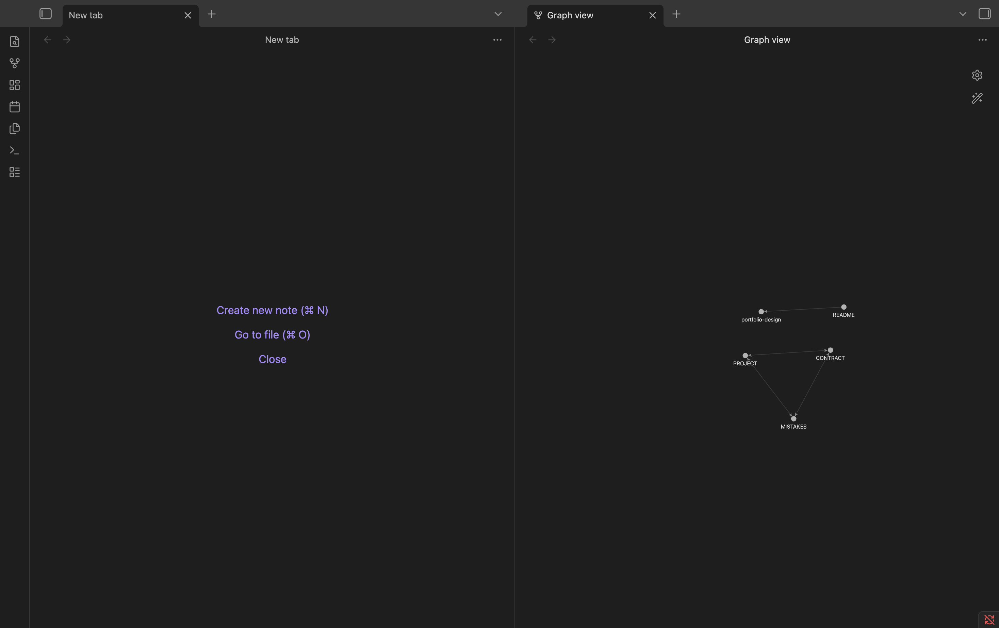
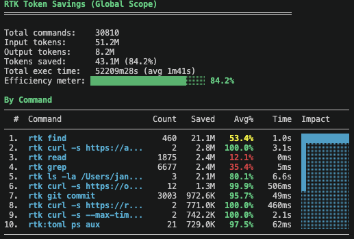

# basecamp

  

A production-ready setup for Claude Code and Codex. Shared coding rules, per-project memory, an agent-neutral review gate, and token optimization.

## Quick Start

```bash
git clone https://github.com/janmaaarc/basecamp.git
cd basecamp
bash setup.sh ~/Documents/your-vault
```

Add `--with-gate` to also install the [review gate](#switching-between-claude-code-and-codex).

Re-running `setup.sh` keeps your edits to `CLAUDE.md`, `RTK.md`, `rules/` and the vault templates. If your copy differs from this repo's, it says so and leaves yours alone. Add `--force` to take this repo's copies instead, which saves the old ones as `.bak` first.

The commands in `bin/` and the git hooks always get overwritten, since those are program code and a re-run is how you pick up fixes.

Then open `~/.claude/CLAUDE.md`, fill in your stack, and follow [Setup](#setup) for tools and plugins. Codex users get `~/.codex/AGENTS.md` generated from the same file.

## What This Is

After building multiple AI and software projects with Claude Code, I found myself repeating the same setup every time. This is that setup, packaged into a reusable foundation: engineering standards, project memory, coding rules, token optimization, and safety mechanisms. Built and refined through real projects, not a template made for show.

Most coding-agent setups are minimal. This one is not. It covers:

- Global instructions your agent follows on every project, as `CLAUDE.md` and `AGENTS.md`
- Karpathy coding principles (think before coding, surgical changes)
- Commit, branch, and PR conventions
- Per-project memory via Obsidian (PROJECT, MISTAKES, CONTRACT, REQUIREMENTS files)
- Requirements checklist filtered by project type (landing/app/saas/api/automation)
- Token optimization via RTK and Headroom
- Safety hooks (block dangerous commands, scan secrets)
- Persistent memory across sessions via claude-mem
- Security scanning of `.claude/` and `~/.codex/` config via agentshield
- A review gate in git, so it applies whichever agent you are using
- Optional Claude Code hooks that enforce "done means verified", auto-format edits, and log which skills and rules actually load

## Screenshots

**Obsidian graph view (PROJECT, MISTAKES, CONTRACT linked)**



**RTK token savings**



## Video Walkthrough

> Coming soon. Full setup walkthrough covering: clone, setup.sh, filling in CLAUDE.md, Obsidian graph view, and token savings demo.

## Requirements

- macOS (Linux partially supported, Windows not tested)
- [Claude Code](https://claude.ai/code) or [Codex](https://github.com/openai/codex), or both
- [Obsidian](https://obsidian.md) (free, for per-project memory files)
- Homebrew (for RTK)
- Python 3.10+ (for Headroom)
- Node.js 18+ (for claude-mem); 22.23.4+ or 24.22.1+ for the optional n8n-mcp server

## Setup

### 1. Run setup script

```bash
bash setup.sh ~/Documents/your-vault
```

This copies all files to `~/.claude/` and your Obsidian vault. Or do it manually:

```bash
mkdir -p ~/.claude/rules
cp CLAUDE.md ~/.claude/CLAUDE.md
cp RTK.md ~/.claude/RTK.md
cp -r rules/ ~/.claude/rules/
mkdir -p ~/.claude/scripts && cp scripts/*.sh ~/.claude/scripts/
cp -r Templates/ ~/Documents/your-vault/Templates/
```

### 2. Update CLAUDE.md

- Open `~/.claude/CLAUDE.md` and fill in your stack, vault path, and defaults
- See `CLAUDE.example.md` for a filled-in reference
- Stack rules in `~/.claude/rules/` load on their own. `typescript.md`, `web.md` and `mobile.md` carry `paths:` frontmatter, so Claude loads each one only when it touches a matching file. `karpathy.md`, `security.md`, `ai-agents.md` and `data.md` load every session. Delete any rule file you don't need. Don't `@`-import the path-scoped ones: an import loads the file every session, which defeats `paths:`.

### 3. Install tools

**RTK (token savings 60-90%):**
```bash
brew tap rtk-ai/tap && brew install rtk
```

**Headroom (context compression):**

Follow the official install guide: https://github.com/headroomlabs-ai/headroom

**claude-mem (persistent memory):**
```bash
npx claude-mem install
echo '(npx claude-mem start &>/dev/null &)' >> ~/.zshrc
```

**agentshield (security scanner, no install needed):**
```bash
npx ecc-agentshield scan
```

### 4. Install Claude Code plugins

> `claude plugin` is a command provided by ECC. Install ECC first using the two commands below, then restart Claude Code before installing the rest.

**Core (recommended for everyone):**
```bash
# ECC: agents, skills, hooks (install this first)
claude plugin marketplace add affaan-m/ECC
claude plugin install ecc@ecc

# Caveman: terse responses
claude plugin marketplace add JuliusBrussee/caveman
claude plugin install caveman@caveman

# Ponytail: YAGNI coding rules
claude plugin marketplace add DietrichGebert/ponytail
claude plugin install ponytail@ponytail

# Safety hooks: block dangerous commands, scan secrets
claude plugin marketplace add poshan0126/dotclaude
claude plugin install safety-hooks@dotclaude
```

**Optional (install what fits your stack):**
```bash
# n8n workflow skills
claude plugin marketplace add czlonkowski/n8n-skills
claude plugin install n8n-mcp-skills@n8n-mcp-skills

# PostgreSQL skills
claude plugin marketplace add timescale/pg-aiguide
claude plugin install pg@aiguide

# UI design rules and auditing
claude plugin marketplace add pbakaus/impeccable
claude plugin install impeccable@impeccable
```

**Optional MCP servers:**
```bash
# Context7: current library docs on demand, remote, no install
claude mcp add --scope user --transport http context7 https://mcp.context7.com/mcp

# n8n-mcp: n8n node schemas and workflow validation, docs mode only
claude mcp add --scope user n8n-mcp -e MCP_MODE=stdio -e LOG_LEVEL=error -e DISABLE_CONSOLE_OUTPUT=true -e N8N_MCP_TELEMETRY_DISABLED=true -- npx -y n8n-mcp@2.99.2
```

n8n-mcp telemetry is on by default and uploads the workflows you validate, so keep `N8N_MCP_TELEMETRY_DISABLED=true`. Without `N8N_API_URL` and `N8N_API_KEY` it cannot edit or delete live workflows. Pin a version: 2.96.2 and later need Node `^22.23.4` or `^24.22.1`. Context7 runs keyless; a free key from context7.com/dashboard raises its rate limits.

### 5. Install for Codex (if you use Codex)

Most of these ship a Codex build. See [Switching Between Claude Code and Codex](#switching-between-claude-code-and-codex) for the full list and the one exception.

```bash
# ECC's guided setup configures Claude Code and Codex in one flow
npx ecc-universal install --guided

codex plugin marketplace add DietrichGebert/ponytail
codex plugin add ponytail@ponytail

npx skills add JuliusBrussee/caveman -a codex
npx impeccable
npx claude-mem install --ide codex-cli

# PostgreSQL skills reach Codex as an MCP server
codex mcp add --url "https://mcp.tigerdata.com/docs" pg-aiguide
```

n8n-mcp-skills installs through Codex's own plugin command; its hooks run in the plugin install, not in individual skill uploads.

Then open `/hooks` in Codex and approve the installed hooks.

Headroom works in Codex as an MCP server. Add to `~/.codex/config.toml`:

```toml
[mcp_servers.headroom]
command = "headroom"
args = ["mcp", "serve"]
```

The optional MCP servers from step 4 go in the same file:

```toml
[mcp_servers.context7]
url = "https://mcp.context7.com/mcp"

[mcp_servers.n8n-mcp]
command = "npx"
args = ["-y", "n8n-mcp@2.99.2"]
env = { "MCP_MODE" = "stdio", "LOG_LEVEL" = "error", "DISABLE_CONSOLE_OUTPUT" = "true", "N8N_MCP_TELEMETRY_DISABLED" = "true" }
```

### 6. Claude Code hooks (optional)

`setup.sh` copies these to `~/.claude/scripts/`. They do nothing until registered in `~/.claude/settings.json`, which setup never edits. Each one needs `jq` and fails open, so a broken script never wedges a session.

| Script | Event | What it does |
|--------|-------|--------------|
| `verify-before-done.sh` | Stop | Blocks the end of a turn that edited code when no typecheck, lint, build or test ran after the last edit. Only edits inside a git work tree count, so files outside any repo (e.g. `~/.zprofile`, `~/.claude.json`) don't trigger it; Markdown, `~/.claude` and `/tmp` edits are skipped too. Spotting a gate command is a heuristic, so an unusual invocation may draw one extra nudge. It nudges once, then lets the stop through, so a repo with no gates cannot loop. |
| `auto-format.sh` | PostToolUse | Formats each edited file with the project's local prettier or eslint (from `node_modules/.bin`), or ruff on your PATH, and only when the project has that tool's config. Never installs anything. `eslint --fix` applies the project's own autofixes, so a rule like unused-imports can remove an import Claude has not used yet. |
| `log-skill-usage.sh` | PreToolUse, UserPromptSubmit | Appends every Skill call and typed `/command` to `~/.claude/state/skill-usage.tsv`. After a couple of weeks, turn off skills that never fire with `skillOverrides`, so the rest trigger reliably. |
| `log-instructions-loaded.sh` | InstructionsLoaded | Logs each `CLAUDE.md` and rules file that loads, and why, to `~/.claude/state/instructions-loaded.jsonl`. Rows with `path_glob_match` prove the `paths:` rules fire. |
| `statusline.sh` | status line | Shows the Ponytail and Caveman badges plus 5-hour and 7-day usage and effort level when Claude Code supplies them. Plugin paths resolve at run time, so plugin updates don't blank it. |

Back up, then merge the hooks into your settings without touching existing ones. Re-running it adds nothing twice, and a failed `jq` leaves your settings as they were:

```bash
f=~/.claude/settings.json
[ -f "$f" ] || echo '{}' > "$f"
cp -n "$f" "$f.bak.$(date +%Y%m%d%H%M%S)"
jq --arg d "$HOME/.claude/scripts" '
  def run(s): "bash \"\($d)/\(s)\"";
  def add(e; entry): if any(.hooks[e][]?.hooks[]?; .command == entry.hooks[0].command) then . else .hooks[e] = ((.hooks[e] // []) + [entry]) end;
  add("Stop"; {hooks: [{type: "command", command: run("verify-before-done.sh"), timeout: 15}]})
  | add("PostToolUse"; {matcher: "Edit|Write|MultiEdit", hooks: [{type: "command", command: run("auto-format.sh"), timeout: 30}]})
  | add("PreToolUse"; {matcher: "Skill", hooks: [{type: "command", command: run("log-skill-usage.sh"), timeout: 5}]})
  | add("UserPromptSubmit"; {hooks: [{type: "command", command: run("log-skill-usage.sh"), timeout: 5}]})
  | add("InstructionsLoaded"; {hooks: [{type: "command", command: run("log-instructions-loaded.sh"), timeout: 5}]})
  | .statusLine = {type: "command", command: run("statusline.sh")}
' "$f" > "$f.tmp" && cat "$f.tmp" > "$f"; rm -f "$f.tmp"
```

Drop any line you don't want. The last line replaces an existing status line. Hook changes apply from the next session.

## How It Works

### Per-Project Memory

Every project gets a folder in your Obsidian vault:

```
your-vault/
  Projects/
    my-app/
      PROJECT.md      <- what the project is, current status
      MISTAKES.md     <- recurring mistakes to avoid
      CONTRACT.md     <- plan for high-risk changes
      DECISIONS.md    <- why X was chosen over Y, append-only
      DEBT.md         <- known gaps deferred on purpose
      REQUIREMENTS.md <- checklist of what shipping this project needs
  Templates/
    PROJECT.md
    MISTAKES.md
    CONTRACT.md
    DECISIONS.md
    DEBT.md
    REQUIREMENTS.md
```

Claude reads these at session start automatically. Update `PROJECT.md` at end of each session (max 30 lines, current status only).

### Requirements Checklist

`Templates/REQUIREMENTS.md` is a master checklist (auth, security, SEO, AI/LLM, DevOps, etc.), each row tagged by project type: `landing`, `app`, `saas`, `api`, or `automation` (n8n/no-code workflow delivery). Set `Type` in a project's `PROJECT.md` and Claude generates that project's own filtered `REQUIREMENTS.md`, so a landing page doesn't see auth/billing rows and an n8n automation doesn't see frontend rows. Checked off only once you confirm an item is actually done, not on Claude's own say-so.

### High-Risk Changes

For schema migrations, auth changes, major refactors:

1. Claude researches first. No implementation yet.
2. Claude creates `CONTRACT.md` with plan, risks, rollback.
3. Claude asks clarifying questions.
4. You approve.
5. Claude implements.
6. You verify.

### Token Optimization

- **RTK**: Filters noisy bash/git/grep output before it hits Claude. 60-90% token savings on commands.
- **Headroom**: Compresses tool outputs (file reads, search results) before they reach Claude.
- **claude-mem**: Injects only relevant past context per session. No full history bloat.
- **Caveman and Ponytail**: Keeps responses and code minimal.

## Switching Between Claude Code and Codex

Both agents read the same rules and hit the same review gate, so switching mid-project changes the model, not the setup.

**Shared.** `setup.sh` writes `~/.claude/CLAUDE.md` for Claude Code and generates `~/.codex/AGENTS.md` for Codex. Codex cannot resolve the `@rules/*.md` imports that Claude Code expands, so `basecamp-sync-agents` flattens them into one file. Re-run it after editing `CLAUDE.md`:

```bash
basecamp-sync-agents                  # ~/.claude/CLAUDE.md -> ~/.codex/AGENTS.md
```

Keeping `AGENTS.md` as a hand-written copy is what this replaces. It drifts the first time you edit the rules and nothing tells you.

This repo checks in a generated `AGENTS.md` so Codex reads the rules straight from a clone. CI fails any PR where it no longer matches `CLAUDE.md`, so edit `CLAUDE.md` and regenerate:

```bash
bash bin/basecamp-sync-agents ./CLAUDE.md ./AGENTS.md
```

**The review gate is git-level, not agent-level.** A `pre-commit` hook blocks any commit whose staged diff has not been reviewed. It fires in Claude Code, Codex, an IDE, or a plain terminal, because they all shell out to the same `git`.

It is opt-in, because it installs via `core.hooksPath`, which is global and overrides every repository's `.git/hooks`. Turning it on unasked would silently disable husky, lefthook or pre-commit wherever you use them.

```bash
bash setup.sh ~/Documents/your-vault --with-gate   # enable it
basecamp-reviewed                                  # record that you reviewed the staged diff
SKIP_REVIEW_GATE=1 git commit ...                  # bypass once
```

The marker stores a hash of the reviewed diff, not a timestamp, so changing anything staged re-arms the gate exactly.

Docs-only diffs under 15 lines skip the gate, matching the Git Rules in `CLAUDE.md`.

**Most plugins ship a Codex build.** Install them per agent:

```bash
# ECC, native Codex plugin, guided setup covers both agents at once
npx ecc-universal install --guided

# Ponytail
codex plugin marketplace add DietrichGebert/ponytail
codex plugin add ponytail@ponytail

# Caveman
npx skills add JuliusBrussee/caveman -a codex

# PostgreSQL skills, as an MCP server
codex mcp add --url "https://mcp.tigerdata.com/docs" pg-aiguide

# Impeccable detects ~/.codex itself
npx impeccable

# Persistent session memory
npx claude-mem install --ide codex-cli

# RTK, instructions into AGENTS.md and RTK.md rather than hooks
rtk init -g --codex
```

After installing or updating anything with Codex hooks, open `/hooks` in Codex and approve them. Codex tracks trust per hook definition, so an update that changes a hook needs re-approval.

**Headroom** is provider-level. Codex reads it as an MCP server in `~/.codex/config.toml`, Claude Code via `ANTHROPIC_BASE_URL`.

**RTK installs for Codex differently.** `rtk init -g --codex` writes instructions into `AGENTS.md` and `RTK.md` rather than patching hooks, so rewriting depends on the agent following them instead of being intercepted before the command runs.

**Not available on Codex.** safety-hooks ships no Codex build. Everything else here installs for both. ECC on Codex exposes instructions, skills and a reviewed hook subset, not the full Claude Code agent set, so a Codex session can record that a review happened without running the same reviewer agent.

## Tools Used

| Tool | Purpose | Codex | Repo | License |
|------|---------|-------|------|---------|
| Headroom | Context compression proxy | Yes, as an MCP server | [headroomlabs-ai/headroom](https://github.com/headroomlabs-ai/headroom) | Apache 2.0 |
| Caveman | Terse response mode | Yes | [JuliusBrussee/caveman](https://github.com/JuliusBrussee/caveman) | MIT |
| ECC | Agents, skills, hooks | Yes, native plugin, reviewed hook subset | [affaan-m/ECC](https://github.com/affaan-m/ECC) | MIT |
| Ponytail | YAGNI coding rules | Yes | [DietrichGebert/ponytail](https://github.com/DietrichGebert/ponytail) | MIT |
| impeccable | UI design rules and auditing (optional) | Yes, detects `~/.codex` | [pbakaus/impeccable](https://github.com/pbakaus/impeccable) | MIT |
| pg-aiguide | PostgreSQL skills (optional) | Yes, as an MCP server | [timescale/pg-aiguide](https://github.com/timescale/pg-aiguide) | Apache 2.0 |
| n8n-mcp-skills | n8n workflow skills (optional) | Yes, hooks in the plugin install | [czlonkowski/n8n-skills](https://github.com/czlonkowski/n8n-skills) | MIT |
| RTK | Token-optimized CLI proxy | Yes, instruction-driven not hook-driven | [rtk-ai/rtk](https://github.com/rtk-ai/rtk) | Apache 2.0 |
| safety-hooks | Block dangerous commands, scan secrets | No | [poshan0126/dotclaude](https://github.com/poshan0126/dotclaude) | MIT |
| claude-mem | Persistent session memory | Yes, `--ide codex-cli` | [thedotmack/claude-mem](https://github.com/thedotmack/claude-mem) | Apache 2.0 |
| agentshield | Scans `.claude/` config for risky permissions, hooks, MCP setups | No, scans Claude Code config | [affaan-m/agentshield](https://github.com/affaan-m/agentshield) | MIT |
| code-review-graph | Codebase graph (MCP and CLI) for blast-radius analysis and token reduction on large-repo reviews (optional) | Yes, as an MCP server | [tirth8205/code-review-graph](https://github.com/tirth8205/code-review-graph) | MIT |
| Context7 | Current library docs on demand (optional) | Yes, as an MCP server | [upstash/context7](https://github.com/upstash/context7) | MIT |
| n8n-mcp | n8n node schemas and workflow validation (optional) | Yes, as an MCP server | [czlonkowski/n8n-mcp](https://github.com/czlonkowski/n8n-mcp) | MIT |

## Maintenance

```bash
# Update plugins. `marketplace update` only refreshes the cache; `plugin update` switches the installed version.
for p in ecc@ecc caveman@caveman ponytail@ponytail safety-hooks@dotclaude; do
  claude plugin marketplace update "${p#*@}"
  claude plugin update "$p"
done

# Regenerate AGENTS.md after editing ~/.claude/CLAUDE.md, so Codex sees the same rules
basecamp-sync-agents

# Update tools
brew upgrade rtk
pipx upgrade headroom-ai    # if you installed Headroom with pipx; there is no `headroom update`
```

Check what is actually active rather than trusting the install output:

```bash
claude plugin list
```

If a plugin update fails with "Plugin dependency install failed (bun)", run `bun upgrade` and retry. Newer plugin lockfiles need a newer bun.

Updates apply only in a new session. End the session, restart the Headroom proxy if you upgraded it (it serves every session, so never mid-session), then fully quit and reopen your editor (Cmd+Q on macOS) so it picks up the new environment. A window reload keeps the old one.

## FAQ

### Do I need Obsidian?

No. The per-project memory system works with any folder. Obsidian just adds graph view and backlinks. Point the vault path in CLAUDE.md to any directory.

### Does this work on Windows?

Claude Code itself has limited Windows support. setup.sh requires bash. Linux is mostly supported. macOS is the primary platform.

### What if I don't use RTK?

Skip it. Remove the `@RTK.md` import from CLAUDE.md. The rest of the setup works without it.

### Do I need all the plugins?

No. Install what fits your workflow. ECC is the most useful. Caveman and Ponytail change how Claude responds. Safety hooks is optional but recommended.

### Can I use this with my stack?

Yes. Fill in Your Defaults in CLAUDE.md, then keep the files in `~/.claude/rules/` that match your stack and delete the rest. The stack-specific ones load only when Claude touches a matching file, and `basecamp-sync-agents` inlines all of them into `AGENTS.md` for Codex.

## License

MIT
